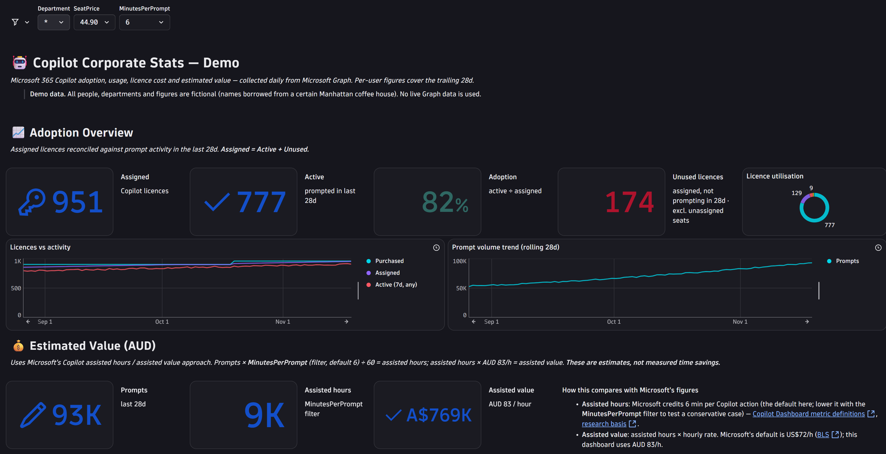
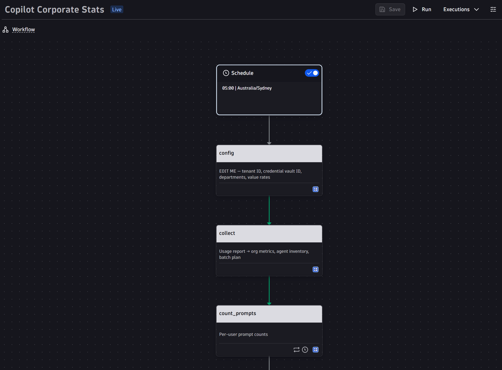
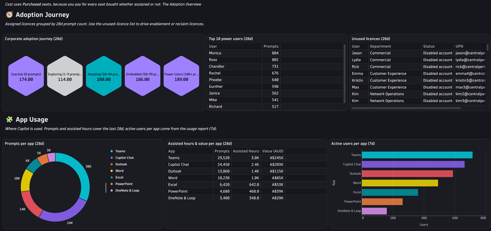
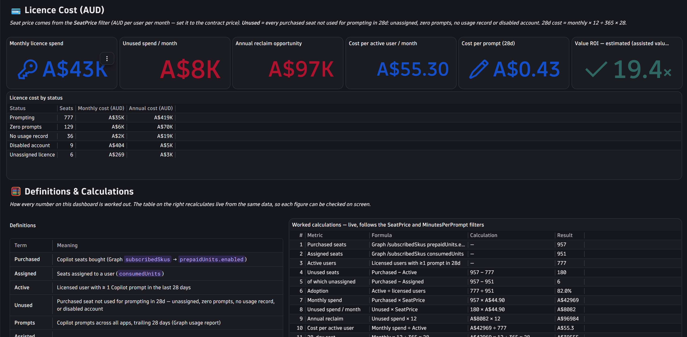
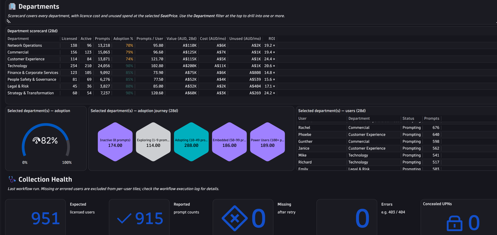

# Microsoft 365 Copilot Usage + Licensing for Dynatrace

A Dynatrace Workflow pulls Copilot usage and licence data from Microsoft Graph once a day and writes it to Grail as metrics. A dashboard turns those metrics into adoption, licence cost, reclaim opportunity and estimated value.

| File | What it is |
|---|---|
| [`workflow/copilot-usage-licensing.workflow.json`](workflow/copilot-usage-licensing.workflow.json) | The workflow, for import in the Workflows app |
| [`workflow/copilot-usage-licensing.workflow.yaml`](workflow/copilot-usage-licensing.workflow.yaml) | Same workflow as YAML, for `dtctl` / CI deployment |
| [`dashboard/copilot-usage-licensing.dashboard.json`](dashboard/copilot-usage-licensing.dashboard.json) | The dashboard (55 tiles) |



*Screenshots use demo data. All people, departments and figures are fictional.*

Both files use placeholders only. Nothing in them is tenant-specific until you edit the `config` task (Step 7).

**Time needed:** about 45 minutes if you have an Entra admin and a Dynatrace admin on hand. Steps 1–2 need the Entra/M365 admin. Steps 3–6 need a Dynatrace admin.

## How it works

```
config → collect → count_prompts (×N batches) → plan_retry → retry_prompts → aggregate → copilot_licence_pull
```



| Task | What it does |
|---|---|
| `config` | **You edit this.** Holds all settings and checks the credentials are readable. |
| `collect` | Reads the Copilot usage report, ingests org-level metrics and the agent inventory, and plans the per-user batches. |
| `count_prompts` | Counts each user's prompts over the last 28 days (batched, 3 in parallel). |
| `plan_retry` / `retry_prompts` | Re-runs users that timed out or were rate-limited, in smaller batches. |
| `aggregate` | Resolves departments from the org chart and ingests the per-user, per-app and collection-health metrics. |
| `copilot_licence_pull` | Ingests purchased/assigned seats and the per-user licence list. Reads its settings from `config`. |
## Before you start

You need:

- An Entra ID admin who can register an app and grant admin consent.
- A Microsoft 365 admin who can change Org settings → Reports (Step 2).
- A Dynatrace admin who can create access tokens, credential vault entries and change **External requests** settings.
- A Dynatrace environment with **Workflows**, **Dashboards** and Grail metrics.
- Agreement from the customer's privacy owner. The metrics carry **UPN, display name and department** as dimensions, so anyone with Grail metric read access can see per-user usage (see [Who can see the data](#who-can-see-the-data)).

## Everything you need to grant, at a glance

Each item is explained in the step shown.

| Where | What | Step |
|---|---|---|
| **Microsoft Graph** (application permissions, admin consent) | `Reports.Read.All`, `AiEnterpriseInteraction.Read.All`, `User.Read.All`, `Organization.Read.All`, and optionally `CopilotPackages.Read.All` | 1 |
| **Microsoft 365** setting | Report name concealment switched **off** | 2 |
| **Dynatrace API token** | Scope `metrics.ingest` only | 3 |
| **Dynatrace credential vault** | Two credentials (Graph client ID and secret, ingest token), both with **App Engine** scope | 4 |
| **Dynatrace outbound connections** | `login.microsoftonline.com`, `graph.microsoft.com`, `<env-id>.live.dynatrace.com` | 5 |
| **Workflow actor** (owner or service user) | Run JavaScript actions, read the two vault credentials, run workflows | 6 |
| **Whoever imports** | Create and edit workflows and dashboards, plus the admin rights from Steps 3–5 | 7, 9 |
| **Dashboard viewers** | Open the dashboard and read Grail metrics (`storage:metrics:read`) | 9 |

IAM permission names differ between tenant generations, so confirm them in your policy editor.

---

## Step 1 · Register an app in Entra ID

1. Entra admin centre → **App registrations** → **New registration**.
2. Name it `Dynatrace Copilot Stats`. Account type: **single tenant**. No redirect URI.
3. Copy the **Application (client) ID** and **Directory (tenant) ID**.
4. **Certificates & secrets** → **New client secret**. Copy the secret **Value** (not the Secret ID) and note the expiry date. When it expires the workflow fails and the dashboard goes stale, so put the date in your handover notes.
5. **API permissions** → **Add a permission** → **Microsoft Graph** → **Application permissions**. Add:

| Permission | Used by | Why |
|---|---|---|
| `Reports.Read.All` | `collect` | Copilot usage report (`getMicrosoft365CopilotUsageUserDetail`) |
| `AiEnterpriseInteraction.Read.All` | `count_prompts`, `retry_prompts` | Per-user prompt counts (`interactionHistory/getAllEnterpriseInteractions`, beta) |
| `User.Read.All` | `aggregate`, `copilot_licence_pull` | User directory, manager chain, per-user licence list |
| `Organization.Read.All` | `copilot_licence_pull` | Purchased and assigned seats (`/subscribedSkus`) |
| `CopilotPackages.Read.All` | `collect` | *Optional.* Agent inventory (beta). If it is missing, that part is skipped and the run still succeeds. |

6. Click **Grant admin consent**. Every row should show a green tick.

> The prompt-count and agent-catalog endpoints are Microsoft **beta** APIs, so Microsoft can change their names or permissions. If a task returns `403` after consent, check the permission name in the current Graph documentation for that endpoint.

## Step 2 · Turn off report name concealment

By default, Microsoft 365 hashes user names in usage reports. Hashed names can't be matched to the licence list, so every licensed user shows as "No usage record".

**Microsoft 365 admin centre** → **Settings** → **Org settings** → **Services** → **Reports** → clear **Display concealed user, group, and site names in all reports**.

This is tenant-wide and exposes real names in all M365 reports, so the customer's privacy or HR owner may need to approve it. The dashboard's **Concealed UPNs** tile turns red while it is still on.

## Step 3 · Create a Dynatrace API token for metric ingest

**Access tokens** → **Generate new token**.

- Name: `copilot-stats-ingest`
- Scope: **`metrics.ingest`** only.

Copy the token (`dt0c01.…`). It is only shown once.

Why a token? The SDK's `metricsClient.ingest()` runs as the workflow actor and needs the platform permission `openpipeline:metrics:ingest`, which many tenants don't grant (it fails with a 403). Ingesting with an API token avoids that. The licence task always ingests with this token, so `ingest.credentialId` must be set in Step 7.

## Step 4 · Store the credentials in the Dynatrace vault

**Settings → Credential vault** (or the Credential Vault app) → **Add credential**. Create two:

| Name | Type | Contents |
|---|---|---|
| `M365 Graph - Copilot Stats` | **Username and password** | Username = Entra **client ID**. Password = client **secret value** |
| `DT Ingest - Copilot Stats` | **Token** | The `metrics.ingest` token from Step 3 |

For **both**:

- Set the credential **scope** to include **App Engine**. Without it, the workflow code can't read the credential.
- If you see **Allow access without app context**, switch it on, because workflows run outside an app.

Copy each credential's ID (`CREDENTIALS_VAULT-…`). You need both in Step 7.

## Step 5 · Allow the outbound connections

Workflow JavaScript can only call allow-listed hosts.

**Settings → General → External requests** (schema `builtin:dt-javascript-runtime.allowed-outbound-connections`). Add:

| Host | Used for |
|---|---|
| `login.microsoftonline.com` | OAuth token for Graph |
| `graph.microsoft.com` | Graph API calls |
| `<your-env-id>.live.dynatrace.com` | Metric ingest with the API token |

Find your env ID in your environment URL: `https://<your-env-id>.apps.dynatrace.com`. The workflow derives the ingest host by swapping `.apps.` for `.live.`. For Managed, sprint or other non-standard hosts, set `ingest.environmentUrl` (Step 7) and allow-list that host instead.

## Step 6 · Let the workflow actor read the credentials

A workflow runs as its **actor** (the owner, or a service user). The actor needs:

- permission to run JavaScript actions (`app-engine:functions:run`)
- permission to read both vault credentials (`environment-api:credentials:read`, or ownership of / access to the two credentials)
- the standard permissions to run and edit workflows

Permission names differ between tenant generations, so confirm them in your IAM policy editor. Use a dedicated **service user** as the actor where you can, so the workflow keeps running if the person who built it leaves.

## Step 7 · Import the workflow and edit the config

1. **Workflows** → **Upload** → choose `workflow/copilot-usage-licensing.workflow.json`.
   (With `dtctl`: use the `.yaml` file.)
2. The workflow imports with its **schedule switched off**. Leave it off for now.
3. Open the **`config`** task and edit the `SETTINGS` block:

| Setting | What to set |
|---|---|
| `graph.tenantId` | Directory (tenant) ID from Step 1 |
| `graph.credentialId` | Vault ID of `M365 Graph - Copilot Stats` |
| `ingest.credentialId` | Vault ID of `DT Ingest - Copilot Stats` (required) |
| `ingest.environmentUrl` | Leave `""` unless the ingest host is non-standard |
| `departmentSource` | `"managerChain"` (default): a user's department is the first department head found walking up their manager chain. `"attribute"`: use an Entra extension attribute instead |
| `departments` | For `managerChain`: department name plus the UPN(s) of its head. **Replace the `@company.com` examples** |
| `orgAttributes`, `departmentAttribute` | For `attribute`: which `extensionAttributeN` holds each value, and which one is the department |
| `unassignedLabel` | Label for users with no department (default `Unassigned`) |

   The remaining settings (`promptWindowDays`, `batchSize`, `timeBudgetMs`, …) are tuned and rarely need changing.

4. That's the only task you must edit. Every other task, including `copilot_licence_pull`, reads these values from `config`.
   - If Copilot is licensed through a bundle (for example M365 E7), open `copilot_licence_pull` and widen `SKU_PATTERN` so it matches that SKU's `skuPartNumber`.

Don't paste secrets into the workflow. It only holds vault IDs.

## Step 8 · Run it manually and check

1. Run the workflow once (**Run**). It can take several minutes for large tenants.
2. Open each task's result:
   - `config` should say `Config OK`.
   - `collect` shows `totalUsers` and a `concealed` count. `concealed` should be `0`.
   - `aggregate` and `copilot_licence_pull` show lines ingested and an empty `invalid` list.
3. In a Notebook, confirm licence data landed. The count should match **Assigned** in M365 admin → Billing → Licences:

```
timeseries v = max(m365copilot.user_licensed), by:{upn}, from: now()-2d
| summarize Users = count()
```

To dry-run the licence task first, set `DRY_RUN = true` in its config block. It calls Graph but ingests nothing.

When it looks right, edit the trigger (default 05:00, Australia/Sydney: change the time and time zone to suit) and switch the schedule **on**. Microsoft's usage reports lag by 24–48 hours, so once a day is enough.

## Step 9 · Import the dashboard

1. **Dashboards** → **Upload** → `dashboard/copilot-usage-licensing.dashboard.json`.
2. Set the filters at the top:

| Variable | What to set |
|---|---|
| `SeatPrice` | **Seat price per user per month**, in the customer's currency. The default list (`44.90, 46.00, 49.39`) is only an example, so replace it with the contract price before any exec review |
| `MinutesPerPrompt` | Minutes saved per prompt (default 6, Microsoft's figure). Lower it to test a conservative case |
| `Department` | Drill-down filter, filled from your data |

3. Anyone viewing needs Grail metric read access (`storage:metrics:read`), or tiles show permission errors.

The dashboard shows nothing until the first full run in Step 8 has completed.

### What's on it

**Adoption journey and app usage.** Seats grouped by 28-day prompt count, the top 10 users, the unused-licence list (your reclaim worklist), and prompts, assisted hours and active users per app.



**Licence cost and definitions.** Monthly spend, unused spend, annual reclaim, cost per active user and per prompt, and estimated ROI. The worked-calculations table recalculates live with the `SeatPrice` and `MinutesPerPrompt` filters, so every figure can be checked on screen.



**Departments and collection health.** A scorecard per department (licensed, active, adoption, cost, unused spend, ROI) with drill-downs driven by the `Department` filter. Collection health shows expected vs reported users, missing users, errors and concealed UPNs, so you can trust the numbers.



The top of the dashboard also covers adoption overview (assigned = active + unused) and estimated value, as in the first screenshot.

### Known limits

- The value section's **hourly rate is fixed at AUD 83/h** in the tile text and query. Edit those tiles for another currency or rate. Currency labels are AUD throughout.
- Value and ROI figures are **estimates** from Microsoft's assisted-hours method. They are not measured productivity.

---

## Who can see the data

The metrics `m365copilot.user_licensed` and `m365copilot.user_prompts` carry `upn`, `user` and `department`. Dashboard access doesn't limit this: anyone who can read Grail metrics can query per-user usage. Agree the audience with the customer, share the dashboard with a group, and restrict `storage:metrics:read` through policy boundaries if required.

Cardinality is one series per user per metric, so a 5,000-seat tenant produces roughly 10k series.

## Troubleshooting

| Symptom | Cause | Fix |
|---|---|---|
| `Cannot read CREDENTIALS_VAULT-…` | Credential lacks **App Engine** scope, or the actor can't read it | Step 4 and Step 6 |
| `403 … openpipeline:metrics:ingest` | Ingest is going through the actor | Set `ingest.credentialId` (Step 7) |
| `AADSTS7000215` / `invalid_client` | Wrong or expired secret, or the secret **ID** was used | Create a new secret and update the vault |
| Graph `403 Authorization_RequestDenied` | Permission missing or no admin consent | Step 1 |
| `fetch failed` / host not allowed | Host not allow-listed | Step 5 |
| Everyone shows "No usage record" | Report concealment is on | Step 2 |
| Licence tiles empty | Licence task not run yet, or only run as a dry run | Step 8 |
| Prompt counts missing for some users | Throttling or timeouts | Check **Collection Health** tiles; the retry pass handles most. Raise `timeBudgetMs` or lower `batchSize` if it persists |
| Licensed count differs from purchased | The usage report counts anyone licensed at any point in the period | Headlines use the *assigned* count |
| Dashboard stops updating | Client secret expired or the workflow failed | Check the latest execution. Consider an alert if `m365copilot.licences.assigned` has no data point for 36h |

## Metrics reference

All metrics are gauges ingested once a day under the prefix `m365copilot` (set by `metricPrefix`). The dashboard depends on these names and dimensions.

| Metric | Dimensions |
|---|---|
| `licences.purchased`, `licences.assigned`, `licences.suspended` | `sku` |
| `user_licensed` | `upn`, `user`, `department`, `sku`, `account_enabled` |
| `user_prompts` | `upn`, `user`, `department` |
| `prompts_by_app`, `active_users_by_app` | `app` |
| `enabled_users`, `active_users`, `adoption_pct` | none |
| `run_users_expected`, `run_users_reported`, `run_users_missing`, `run_users_capped`, `report_concealed_upns` | none |
| `run_users_status` | `status` |
| `org_users`, `org_membership`, `org_manager`, `org_cycles_guarded` | org hierarchy (not used by the dashboard) |
| `agents_total`, `agents_without_owner`, `agents_by_creator`, `agents_by_platform` | agent inventory (not used by the dashboard) |
